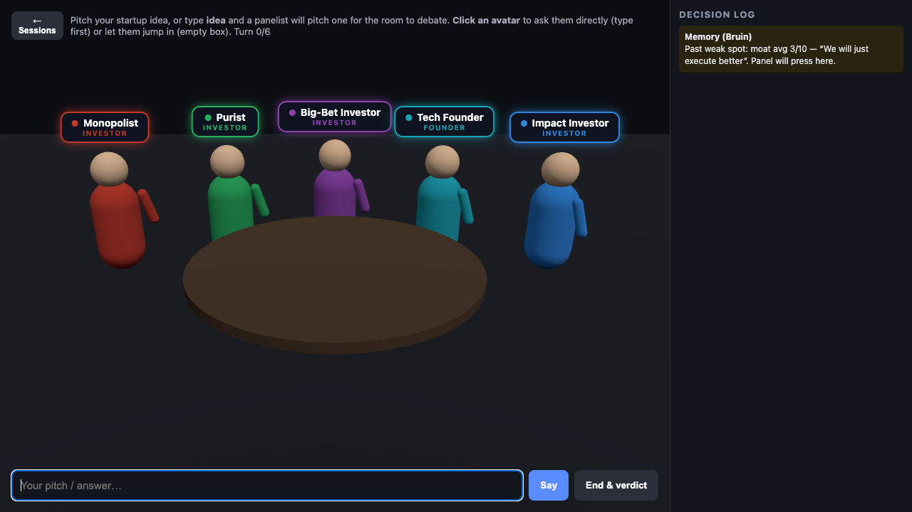

# [Startup Crucible](https://ammonia-overprice-dosage.ngrok-free.dev/)

**A 3D boardroom where AI investor and founder personas grill your startup idea, argue with each other, and hand down an evidence-backed verdict.**

Built for the multiplayer AI hackathon, **Track 3: Grow with Agents**. The roles are reversed: the agents are the experts, and you are the one being trained.

[](https://ammonia-overprice-dosage.ngrok-free.dev/)

## What happens in a session

1. **Assemble the room.** Pick 3 to 5 of 8 archetypes: the Monopolist Strategist, the User-Pull Purist, the Big-Bet Investor, the Pragmatic Operator, the Impact Investor, the Technical Founder, the Bootstrapper, the Growth Founder. They are personas, not real people.
2. **Pitch.** Type your idea, or type `idea` and one panelist walks to the front of the table and pitches a startup idea or societal problem in their own worldview. The rest of the panel debates it, reacting to each other.
3. **Get grilled.** Each turn, every panelist reacts in character, scores your answer 0 to 10, and states why. Their stance shows in their body language: they sink and tilt their head when skeptical, rise when sold.
4. **Take control.** Click an avatar to give them the floor. With text in the box, the question goes to that panelist only. With an empty box, they jump in unprompted to challenge something that was said.
5. **Verdict.** After 6 turns (or **End & verdict**) you get FUNDED or PASS, with a per-panelist breakdown that quotes your best and worst moments and ties each score to what you actually said.
6. **Come back stronger.** Weak topics from past sessions are fed back into the panel's prompts, so they press harder where you were weak before.

Sessions are saved. The home screen lists all your boardrooms (like a chat history), and reopening one restores its transcript, decision log, and the panel's stances.

## How it meets the track requirements

| Requirement | Where it lives |
|---|---|
| Agents as visible 3D characters | Three.js avatars with nameplates, one per archetype (`main.js`) |
| Movement and action, not just text | Speakers gesture and bob, stance changes posture, the pitcher walks to the front, hover and speaking rings |
| 3+ agents with distinct goals | 8 archetypes, 3 to 5 per room, each with its own persona prompt (`AGENTS` in `server.js`) |
| Agents coordinate about the human | One shared panel call per turn: panelists react to you and to each other; the panel debates `idea` pitches |
| Agents adapt to the human | Per-turn scores and stances; Bruin-derived weak spots change what the panel presses on next session |
| Decision log | Right-hand panel: each reaction with stance, score, topic and a reason that cites your words |
| Evidence-based feedback | Verdict quotes your best and worst line per panelist with the reasons behind each score |
| Voice | Each archetype has its own Gemini TTS voice, with browser-voice fallback |
| Bruin | Event log to DuckDB analytics pipeline that feeds memory back into the panel (below) |

## Bruin pipeline

The server appends every scored founder turn to `data/events.jsonl`. A [Bruin](https://getbruin.com) pipeline (`my-pipeline/`) turns that into analytics and cross-session memory:

```
data/events.jsonl
      │  raw.session_events        (duckdb.sql: load the log)
      ├─▶ analytics.agent_scores           (avg score per session and panelist, with quality checks)
      └─▶ analytics.founder_weak_spots     (worst topics across sessions, with your worst quote as evidence)
                    │
                    ▼   `bruin query` at session start
        panel prompts: "press on these past weak spots"
```

- `End & verdict` runs `bruin run my-pipeline`, so the tables refresh when a session finishes. Memory from a session shows up the next time you open a boardroom.
- Only your own turns are logged. Panel-only content (the `idea` pitch and debate, jump-ins) is not, so it never counts against you.
- A seed row ships in `data/events.jsonl` so a fresh clone shows the memory feature immediately.

## Run it

**Prerequisites:** Node 20+, the [Bruin CLI](https://getbruin.com), and a Gemini API key from [Google AI Studio](https://aistudio.google.com/apikey).

```bash
git clone https://github.com/elwincheng/startup-crucible.git
cd startup-crucible
npm install

# Bruin connection (this file is gitignored because it can hold credentials)
cat > .bruin.yml <<'EOF'
default_environment: default
environments:
  default:
    connections:
      duckdb:
        - name: duckdb-default
          path: duckdb.db
EOF

bruin run my-pipeline            # builds the analytics tables from the seed row

export GEMINI_API_KEY=your-key
npm run dev                      # API on :8787, web on http://localhost:5173
```

Open http://localhost:5173, click **+ New boardroom**, pick your panel, and pitch. Use Chrome (the browser it was built and checked in); the 3D scene needs WebGL.

Without a key the server starts in an offline mock mode with canned replies, which is only good for checking the UI.

| Variable | Default | Purpose |
|---|---|---|
| `GEMINI_API_KEY` (or `GOOGLE_API_KEY`) | none | Gemini access for panel turns, ideas and voices |
| `GEMINI_MODEL` | `gemini-3.8-flash` | Primary chat model |
| `GEMINI_FALLBACKS` | auto-discovered | Comma-separated fallback chat models |
| `GEMINI_TTS_MODEL` | auto-discovered | Preferred TTS model |
| `PORT` | `8787` | API port |

At startup the server asks your key which models it can use and builds the fallback chain and TTS choice from that, so a quota or overload error on one model moves to the next instead of failing the turn.

## Project layout

```
index.html, main.js     Frontend: Three.js scene, nameplates, picker, home screen, voices, verdict
server.js               API: Gemini panel/idea/jump-in calls, TTS, session storage, Bruin bridge
my-pipeline/            Bruin pipeline (events to DuckDB analytics and memory)
data/events.jsonl       Founder-turn event log that feeds Bruin
data/sessions/          Saved boardroom sessions (gitignored)
docs/boardroom.png      Screenshot
```

## Honest limitations

- **Avatars are low-poly primitives** (capsules and spheres), animated procedurally. The effort went into behavior over models.
- **"Learning" is memory, not training.** There is no RL or fine-tuning. Adaptation comes from scores and stances within a session, and from Bruin-derived weak spots injected into prompts across sessions.
- **Scores are an LLM's judgment.** The reasons cite your words, but the 0 to 10 number is model-generated and can vary.
- **No automated tests yet.** The pipeline has two Bruin quality checks, and the app was checked by hand and with headless-browser renders.
- **Depends on Gemini quota and capacity.** The server retries and falls back across models, and the voices fall back to the browser's, but a full outage would stall a turn.
- **Single-user and local.** Sessions are JSON files on the machine running the server.
